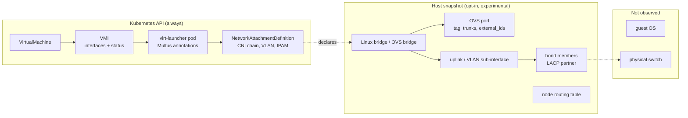
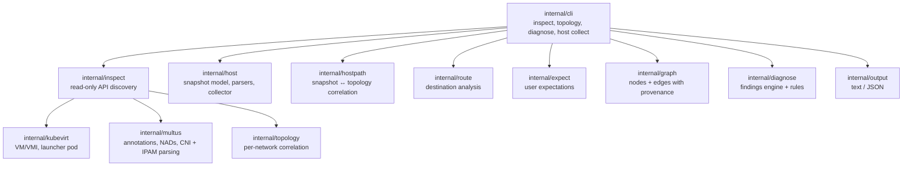

# kubevirt-netdoctor

[](https://github.com/sudharsanomprakash/kubevirt-netdoctor/actions/workflows/ci.yml)
[](LICENSE)

Open-source network diagnostics and topology tracing for KubeVirt virtual machines,
Multus and Kubernetes networking.

`kubectl netdoctor` is a read-only kubectl plugin that explains how a KubeVirt VM is
wired into the network. It correlates the VM's interfaces, the virt-launcher pod,
Multus attachments and NetworkAttachmentDefinitions and, from an explicitly collected
host snapshot, the node's bridges, OVS ports, VLANs, bonds and routes. It reports
structured findings that say what is wrong, how certain that is, what was expected and
what to check next.

> **Status: early development (v0.x).** The CLI and the JSON schema may change between
> minor versions. Features marked **experimental** may change more. netdoctor never sends
> traffic: connectivity is not tested by any command.

> **Disclaimer:** kubevirt-netdoctor is an independent community project. It is not
> affiliated with, sponsored by or endorsed by Red Hat, the Cloud Native Computing
> Foundation (CNCF), the Kubernetes or KubeVirt projects, or the author's employer.
> All names and trademarks belong to their respective owners.

## Why

A VM's traffic crosses many layers:

```
Guest VM -> virt-launcher pod -> Multus -> CNI plugin -> OVS / Linux bridge -> host NIC / bond -> VLAN -> physical switch
```

When something breaks, the evidence is spread across VirtualMachine and
VirtualMachineInstance objects, pod annotations, NetworkAttachmentDefinitions and node
state. netdoctor gathers what the Kubernetes API and the node expose, lines it up per VM
network, and is explicit about what it could not see.

## What is observed

| Layer | Source | Command |
| --- | --- | --- |
| VM / VMI spec, phase, node, conditions, guest interfaces | Kubernetes API | all |
| virt-launcher pod (label **and** owner reference) | Kubernetes API | all |
| Multus requested and reported attachments | Kubernetes API (pod annotations) | all |
| NAD CNI configuration: plugin chain, bridge, VLAN, trunks, MTU, IPAM subnets/gateways/routes | Kubernetes API | all |
| Host interfaces, Linux bridges and their VLAN tables, VLAN sub-interfaces, bonds, routes | host snapshot *(experimental)* | `topology`, `diagnose` |
| OVS bridges, ports (tags, trunks, external IDs), interfaces, bonds, LACP, flow summaries | host snapshot *(experimental)* | `topology`, `diagnose` |
| Guest OS routes and firewall, pod network namespace, physical switch | **not observed** | |
| Packet forwarding / connectivity | **not tested** | |



## Architecture



Every relationship carries a provenance:

- **Observed**: reported by the Kubernetes API or the host snapshot.
- **Declared**: stated by configuration (VMI spec, NAD config, expectations file).
- **Inferred**: derived from documented behavior (for example binding semantics) or a
  matching heuristic (for example matching a Multus entry by order because no interface
  name was available).

Layers that could not be observed are listed as **gaps**; elements whose source was
readable but did not contain them are listed as **absent**.

## Installation

Requires Go 1.26 or newer to build.

```sh
go install github.com/sudharsanomprakash/kubevirt-netdoctor/cmd/kubectl-netdoctor@latest
```

Or build from source with `make build` and put `bin/kubectl-netdoctor` on your `PATH`.
Any executable named `kubectl-netdoctor` on the `PATH` is available as `kubectl netdoctor`.
The binary is statically linked, so the same file can be copied to a node for
`host collect`.

## Commands

```sh
# Kubernetes API checks (unchanged since v0.1)
kubectl netdoctor inspect vm/web-01 -n demo

# Topology graph; add a host snapshot to extend it to the node
kubectl netdoctor topology vm/db-03 -n demo
kubectl netdoctor topology vm/db-03 -n demo --host-snapshot worker-2.json -o json

# All diagnostics, optionally with host data, expectations and a destination
kubectl netdoctor diagnose vm/db-03 -n demo --destination 203.0.113.9
kubectl netdoctor diagnose vm/db-03 -n demo --host-snapshot worker-2.json --expectations expect.yaml -o json

# On the VM's node (experimental, see "Host collector security model")
kubectl-netdoctor host collect --node-name worker-2 --file /tmp/worker-2.json

kubectl netdoctor version
```

All cluster commands accept the standard kubectl flags (`--kubeconfig`, `--context`,
`--namespace`, ...), `--output text|json` and `--timeout` (default 60s, covering the
whole command; individual API requests are also bounded). Ctrl-C cancels in-flight
requests. `kubectl netdoctor version` reports the git commit the binary was built from
(from `-ldflags`, or the VCS information Go embeds when building from a checkout).
Exit status is `0` when the command completed, regardless of findings, and
`1` when it could not run.

### Example: topology

A VM with an OVS CNI attachment on VLAN 200, with a host snapshot of its node
(`testdata/golden/topology-ovs.txt`; all data synthetic). The walk follows the packet
path: guest interface → pod interface → NAD → OVS bridge → uplink bond → members, and
separately the OVS port that OVS CNI created for the pod, identified by its
`external_ids`.

```text
Topology:  VirtualMachine demo/db-03
VMI:       phase=Running  node=worker-2
Launcher:  virt-launcher-db-03-p8w4k
Host:      snapshot of node worker-2 collected 2026-01-01T00:00:00Z

network default {binding=masquerade, source=pod}
  +- realized-as -> GuestInterface demo/db-03/default {infoSource=domain, guest-agent, interfaceName=enp1s0, ips=10.244.2.33, mac=02:00:00:00:00:0e}  [Observed] VMI status.interfaces
  |  +- bound-to -> PodInterface demo/virt-launcher-db-03-p8w4k/eth0 {ips=10.244.2.33, mac=0a:58:0a:f4:02:21, network=k8s-pod-network}  [Inferred] masquerade binding: guest traffic is NATed to the pod interface address
  |  |  +- member-of -> ClusterNetwork k8s-pod-network  [Declared] pod network (primary CNI)
  +- attached-via -> PodInterface demo/virt-launcher-db-03-p8w4k/eth0 {ips=10.244.2.33, mac=0a:58:0a:f4:02:21, network=k8s-pod-network}  [Observed] matched by defaultFlag (shown above)

network data {binding=bridge, source=multus}
  +- realized-as -> GuestInterface demo/db-03/data {infoSource=domain, guest-agent, multus-status, interfaceName=enp2s0, ips=198.51.100.33, mac=02:00:00:00:c8:03}  [Observed] VMI status.interfaces
  |  +- bound-to -> PodInterface demo/virt-launcher-db-03-p8w4k/pod3e9a1c7b2d0 {mac=02:00:00:00:c8:03, network=demo/ovs-vlan200}  [Inferred] bridge binding: the pod interface is bridged to the guest at layer 2
  |  |  +- created-from -> NetworkAttachmentDefinition demo/ovs-vlan200 {cni=ovs(br=br-data,vlan=200), lookup=Found}  [Observed] network-status entry names the NAD
  |  |  |  +- uses-host-device -> OVSBridge br-data {mtu=9000, operState=up, type=ovs-bridge}  [Declared] NAD config names "br-data"; present in the host snapshot
  |  |  |  |  +- uplink -> HostInterface bond1 {type=ovs-bond, vlans=200,300}  [Observed] host snapshot port membership
  |  |  |  |  |  +- is-bond -> Bond bond1 {mode=balance-tcp, type=ovs}  [Observed] host snapshot
  |  |  |  |  |  |  +- member -> BondMember bond1/ens1f0 {partner=02:aa:00:00:00:01, state=attached}  [Observed] host snapshot bond membership
  |  |  |  |  |  |  +- member -> BondMember bond1/ens1f1 {partner=02:aa:00:00:00:01, state=attached}  [Observed] host snapshot bond membership
  |  |  +- plugged-into -> OVSPort veth3e9a1c7b {bridge=br-data, tag=200, vlanMode=access}  [Observed] external_ids owner+contPodUid+contIface
  |  |  |  +- port-of -> OVSBridge br-data {mtu=9000, operState=up, type=ovs-bridge}  [Observed] OVSDB Bridge.ports (shown above)
  +- attached-via -> PodInterface demo/virt-launcher-db-03-p8w4k/pod3e9a1c7b2d0 {mac=02:00:00:00:c8:03, network=demo/ovs-vlan200}  [Observed] matched by podInterfaceName (shown above)
  +- references -> NetworkAttachmentDefinition demo/ovs-vlan200 {cni=ovs(br=br-data,vlan=200), lookup=Found}  [Declared] spec.networks[].multus.networkName (shown above)

ABSENT (0): sources were readable but did not contain these

GAPS (0): not observable

Provenance: Observed = reported by the Kubernetes API or host snapshot; Declared = stated by configuration; Inferred = derived from documented behavior or matching heuristics.
Connectivity: NOT TESTED. Read-only Kubernetes API inspection plus a host snapshot of node worker-2 collected at 2026-01-01T00:00:00Z. Host state may have changed since; configuration does not prove forwarding. Guest and switch state were not observed.
```

### Example: diagnose with a host snapshot

A Linux bridge attachment whose uplink bond has a member in a different 802.3ad
aggregator, negotiated with a different LACP partner
(`testdata/golden/diagnose-linux-bond.txt`):

```text
Target:    VirtualMachine demo/web-01
VM:        web-01  runStrategy=Always  status=Running
VMI:       web-01  phase=Running  node=worker-1  guestAgent=Connected
Launcher:  virt-launcher-web-01-x7k2p  phase=Running  node=worker-1

NETWORKS (2)
  default  [pod network, binding: masquerade]
    guest:  iface enp1s0  mac 02:00:00:00:00:0a  ips 10.244.1.15  source domain, guest-agent
    pod:    iface eth0  network k8s-pod-network  mac 0a:58:0a:f4:01:0f  ips 10.244.1.15 (Multus network-status)
  vlan100  [multus demo/br-vlan100, binding: bridge]
    guest:  iface enp2s0  mac 02:00:00:00:64:01  ips 192.0.2.10  source domain, guest-agent, multus-status
    pod:    iface pod5c6f2b9e0d1  network demo/br-vlan100  mac 02:00:00:00:64:01 (Multus network-status)
    nad:    found; cni bridge(br=br1,vlan=100) -> tuning

HOST PATH (snapshot of node worker-1, collected 2026-01-01T00:00:00Z)
  source ovsdb: NotInstalled ovs-vsctl is not installed
  default  [PodNetwork]
    note: the cluster network data path is CNI-specific; netdoctor checks host routes for it with diagnose --destination
  vlan100  [LinuxBridge br1: Found]
    device: type linux-bridge  state UP  mtu 9000  vlan_filtering true
    uplink: bond0 (bond, UP, mtu 9000, vlans 1,100)
      bond linux 802.3ad: eno1 partner 02:aa:00:00:00:01; eno2 DETACHED (in aggregator 2, active aggregator is 1) partner 02:bb:00:00:00:02
    note: the host veth of a Linux bridge attachment cannot be identified without entering the pod network namespace

FINDINGS (2): 1 error(s), 1 warning(s), 0 info
  ERROR   LACP_PARTNER_MISMATCH [Confirmed] Node worker-1 (host snapshot)
          Members of bond "bond0" negotiated LACP with different partners
          - partner 02:aa:00:00:00:01 via eno1
          - partner 02:bb:00:00:00:02 via eno2
          expected: one LACP partner system for all members (consistency between members)
          next: Verify that all member ports are in the same LAG (or MLAG pair presenting one system ID) on the switch.
  WARNING BOND_MEMBER_DETACHED [Confirmed] Node worker-1 (host snapshot)
          Bond "bond0" on the path of network "vlan100" has detached members
          - eno2: in aggregator 2, active aggregator is 1
          expected: all members attached
          next: Check the member links and the switch-side LAG configuration (ovs-appctl bond/show or /proc/net/bonding/bond0).

Connectivity: NOT TESTED. Read-only Kubernetes API inspection plus a host snapshot of node worker-1 collected at 2026-01-01T00:00:00Z. Host state may have changed since; configuration does not prove forwarding. Guest and switch state were not observed.
```

### Example: destination analysis

`diagnose --destination` reports which VM network would carry the traffic according to
declared configuration, and whether the guest's reported addresses corroborate it
(`testdata/golden/diagnose-ovs-healthy.txt`):

```text
ROUTE TO 203.0.113.9 (configuration analysis)
  selected:  network data, Route 203.0.113.0/24 via 198.51.100.1 [Declared] IPAM route 203.0.113.0/24 of demo/ovs-vlan200
             the guest reports 198.51.100.33 inside the declared subnets
  candidate: network data, Route 203.0.113.0/24 via 198.51.100.1 [Declared] IPAM route 203.0.113.0/24 of demo/ovs-vlan200
  candidate: network default, Default 0.0.0.0/0 [Inferred] KubeVirt provides the guest default route on the pod network for masquerade binding
  node:      not applicable; network "data" is bridged at layer 2; the node routing table is not on its path
  note:      configuration analysis only: no packets were sent
  note:      the guest's own routing table is not observable through the Kubernetes API
  note:      NAD IPAM subnets and routes configure the pod interface; the guest uses them only if they are delivered to it (binding-dependent) or configured in the guest
```

## Supported diagnostics

Each finding has a stable ID, a severity, a confidence category (`Confirmed`,
`Suspected`, `Unavailable`), the affected resource, observed evidence, the expected state
and where that expectation came from, and a recommended next step. The full list is in
[`docs/findings.md`](docs/findings.md).

| Area | Findings | Needs |
| --- | --- | --- |
| VM / launcher pod | `VMI_NOT_RUNNING`, `LAUNCHER_POD_MISSING`, `LAUNCHER_POD_AMBIGUOUS`, `LAUNCHER_POD_MULTIPLE`, `LAUNCHER_NODE_MISMATCH` | API |
| Multus | `MULTUS_ATTACHMENT_MISSING`, `MULTUS_ATTACHMENT_MISMATCH`, `MULTUS_REQUEST_MISSING`, `MULTUS_STATUS_UNAVAILABLE`, `MULTUS_ANNOTATION_INVALID` | API |
| NAD | `NAD_NOT_FOUND`, `NAD_REFERENCE_INVALID`, `NAD_CONFIG_INVALID`, `NAD_CONFIG_SUSPICIOUS`, `NAD_CONFIG_NOT_INLINE` | API |
| VM interfaces | `INTERFACE_STATUS_MISMATCH`, `GUEST_IP_UNAVAILABLE` | API |
| Host devices | `HOST_INTERFACE_MISSING`, `HOST_INTERFACE_DOWN` | host snapshot |
| OVS | `OVS_PORT_MISSING`, `OVS_PORT_WRONG_BRIDGE`, `OVS_BRIDGE_NO_FLOWS` | host snapshot |
| VLAN / MTU | `VLAN_MISMATCH`, `VLAN_NOT_ENFORCED`, `MTU_MISMATCH` | NAD config or expectations; host snapshot for host checks |
| Bonds | `BOND_MEMBER_DETACHED`, `LACP_PARTNER_MISMATCH` | host snapshot; expectations for expected members/partner |
| Routes | `ROUTE_MISSING`, `ROUTE_UNDETERMINED`, `ROUTE_AMBIGUOUS`, `ROUTE_GATEWAY_OFFLINK`, `HOST_ROUTE_MISSING`, `HOST_ROUTE_REJECTED`, `HOST_ROUTE_EGRESS_DOWN` | `--destination`; host snapshot for node checks |
| Coverage | `TOPOLOGY_INCOMPLETE`, `HOST_SNAPSHOT_NODE_MISMATCH`, `HOST_SNAPSHOT_HOSTNAME_MISMATCH`, `HOST_COLLECTOR_UNAVAILABLE`, `ACCESS_DENIED`, `API_UNAVAILABLE` | |

netdoctor never invents expected values. VLAN, MTU and bond checks compare against
the NAD configuration or against [an expectations file](examples/expectations.yaml)
you supply; LACP partners are compared only between members of the same bond or with
a partner ID you declare. A configuration that agrees everywhere does **not** prove that
packets are forwarded.

## Required RBAC permissions

The cluster commands only read:

| API group | Resource | Verb | Used for |
| --- | --- | --- | --- |
| `kubevirt.io` | `virtualmachines` | `get` | VM run strategy, status, template networks |
| `kubevirt.io` | `virtualmachineinstances` | `get` | interfaces, phase, node, guest status |
| `""` (core) | `pods` | `list` | virt-launcher pod discovery and Multus annotations |
| `k8s.cni.cncf.io` | `network-attachment-definitions` | `get` | NAD CNI configuration |

`topology` and `diagnose` need nothing beyond `inspect`; a host snapshot is a local
file. API discovery uses the default `system:discovery` permissions. NADs referenced as
`<namespace>/<name>` need `get` in that namespace. See
[`examples/rbac.yaml`](examples/rbac.yaml). Missing permissions produce `ACCESS_DENIED`
findings and partial results instead of failures.

## Host collector security model (experimental)

`kubectl netdoctor host collect` is the only part of netdoctor that touches a node.

- **Opt-in and operator-run.** netdoctor never deploys anything: no DaemonSet, no debug
  pod, no privileged component. An operator runs the collector on the node explicitly
  and passes the resulting file to `--host-snapshot`.
- **Read-only, fixed commands, no shell.** It runs only `ip -j -d link show`,
  `ip -j addr show`, `ip -j -4/-6 route show table all`, `bridge -j vlan show`,
  `ip -j netns list`, `ovs-vsctl --format=json list Bridge|Port|Interface` (selected
  columns), `ovs-appctl bond/show`, `ovs-appctl lacp/show` and
  `ovs-ofctl dump-flows <bridge>`, and reads `/proc/net/bonding/*`. Commands are executed
  directly (never through a shell), no user input becomes an argument, and the only
  dynamic argument (an OVS bridge name read from OVSDB) is validated first.
- **Least privilege.** Link, address, route and bridge VLAN state is readable as an
  unprivileged user. OVS (database and `ovs-vswitchd` control sockets) and
  `/proc/net/bonding` typically need root or membership in the group owning the OVS
  sockets. Run with the least privilege that covers what you need; anything unreadable
  is recorded as `Failed` in the snapshot and reported as `HOST_COLLECTOR_UNAVAILABLE`,
  never silently treated as absent. `--skip-ovs` and `--skip-flows` reduce the scope.
- **Bounded.** Each command has a timeout (`--command-timeout`, default 10s);
  Ctrl-C stops collection.
- **Output.** The snapshot file is created with mode `0600`. It contains interface
  names, MAC and IP addresses, routes and OVS external IDs (including pod UIDs). Treat it
  as sensitive and review it before sharing.

One way to run it, if your policy allows node debugging (this is your action, not
netdoctor's). Copy the static binary to the node first (here `/usr/local/bin`); depending
on the cluster, reading OVS state may require a privileged debug profile such as
`--profile=sysadmin`:

```sh
kubectl debug node/worker-2 -it --image=<an image with a shell> -- chroot /host \
  /usr/local/bin/kubectl-netdoctor host collect --node-name worker-2 --file /tmp/worker-2.json
# then copy /host/tmp/worker-2.json out of the debug pod with kubectl cp
```

Run the collector **on the node that hosts the VM** (see `NODENAME` in
`kubectl get vmi`), not on the machine you run kubectl from. `--node-name` must be the
Kubernetes node name. The collector refuses a `--node-name` whose first DNS label differs
from the host's own name, unless you pass `--allow-node-name-mismatch` (for kubelets
with `--hostname-override`); such snapshots are flagged with
`HOST_SNAPSHOT_HOSTNAME_MISMATCH`. Snapshots whose node does not match the VMI's node are
not correlated (`HOST_SNAPSHOT_NODE_MISMATCH`).

## Troubleshooting

| Symptom | Meaning and next step |
| --- | --- |
| `Error: VirtualMachine "x" not found` | Wrong name or namespace; use `-n`. |
| `not permitted to read VirtualMachine` / `ACCESS_DENIED` | Missing RBAC; apply [`examples/rbac.yaml`](examples/rbac.yaml) for the namespace. |
| `dial tcp 127.0.0.1:8080: connect: connection refused` | No kubeconfig was found, so client-go fell back to `localhost:8080`. Pass `--kubeconfig`/set `KUBECONFIG`. Do not run `inspect`, `topology` or `diagnose` with `sudo`: it resets `HOME` and drops `KUBECONFIG`. Only `host collect` needs elevated privileges. |
| `the cluster does not serve virtualmachines.kubevirt.io` | KubeVirt is not installed or the context points at another cluster. |
| `HOST_SNAPSHOT_NODE_MISMATCH` | The snapshot came from another node, or `--node-name` was not the Kubernetes node name. Re-collect on the node in `VMI status.nodeName`. |
| `ROUTE_UNDETERMINED` | The VM's addressing on a secondary network is configured inside the guest (no NAD IPAM), so the path cannot be derived from configuration. Check `ip route get <destination>` inside the guest. |
| `HOST_COLLECTOR_UNAVAILABLE` for `ovsdb` | The collector could not reach the OVS database, usually for lack of privileges. Re-run as root or with access to the OVS sockets. |
| `TOPOLOGY_INCOMPLETE` | Some layers were not observable; the evidence lists which. Provide a host snapshot, fix permissions, or install the guest agent. |
| No findings but traffic still fails | Nothing contradictory was found in the observed configuration; connectivity was not tested. Continue with data-plane tools on the node, for example `ovs-appctl ofproto/trace`, `tcpdump` on the uplink, and the switch-side port and LAG state. |

## Limitations

- No packet probes, captures or OpenFlow tracing; nothing proves forwarding.
- Pod and guest network namespaces are not entered. The host veth of a Linux bridge
  attachment therefore cannot be tied to a specific pod. OVS CNI ports can, exactly
  when OVS CNI records the pod UID in `external_ids`; with older OVS CNI versions the
  match is by interface name and is reported as Inferred.
- Host route analysis uses the main table only; policy routing and VRFs are not
  evaluated. The cluster network's own data path (Calico, OVN-Kubernetes, ...) is
  CNI-specific and not modeled beyond the node routing table.
- NAD IPAM configures the pod interface; whether the guest uses that addressing depends
  on the binding and guest configuration. Route candidates show whether guest-reported
  addresses corroborate it.
- SR-IOV, host-device and OVN-Kubernetes secondary networks are identified but their
  host data path is not modeled.
- kubernetes-nmstate `NodeNetworkState` is not yet used as a host data source.
- A host snapshot is a point-in-time copy; state may have changed since collection.
- Not yet validated against live clusters across KubeVirt versions.

## Roadmap

Planned, not implemented:

- `NodeNetworkState` (kubernetes-nmstate) as an API-only host data source.
- Live-cluster end-to-end tests (kind + KubeVirt + Multus + OVS) in CI.
- Opt-in eBPF tracing of a VM's packets along its host data path, reported separately
  from configuration findings: see [proposal 0001](docs/proposals/0001-ebpf-trace.md)
  (draft).
- Opt-in connectivity probes, clearly reported as such.
- SR-IOV resource and VF state; OVN-Kubernetes secondary network checks.
- krew plugin index distribution.

See [`docs/gap-analysis.md`](docs/gap-analysis.md) for how this compares with
existing tools.

## Contributing

Contributions are welcome. Please read [CONTRIBUTING.md](CONTRIBUTING.md) for the
development workflow and the principles for writing diagnostics, and follow the
[Code of Conduct](CODE_OF_CONDUCT.md). Report security issues privately as described in
[SECURITY.md](SECURITY.md).

## License

Apache License 2.0. See [LICENSE](LICENSE).
