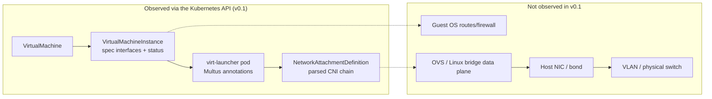
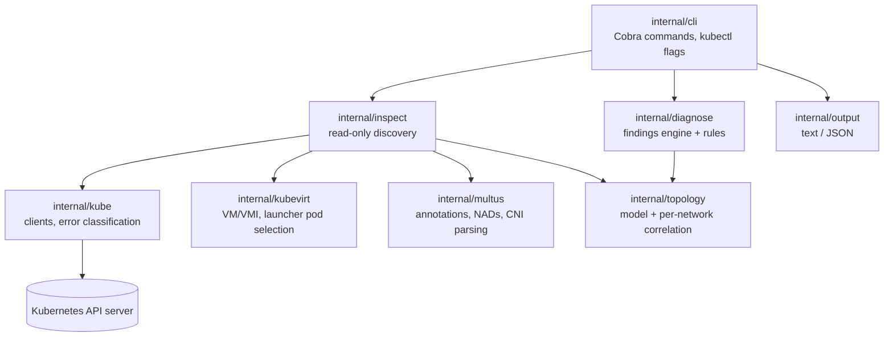

# kubevirt-netdoctor

[](https://github.com/sudharsanomprakash/kubevirt-netdoctor/actions/workflows/ci.yml)
[](LICENSE)

Open-source network diagnostics and topology tracing for KubeVirt virtual machines,
Multus and Kubernetes networking.

`kubectl netdoctor` is a read-only kubectl plugin that explains how a KubeVirt VM is
wired into the cluster network. It correlates the VM's interfaces, the
virt-launcher pod, Multus attachments and NetworkAttachmentDefinitions, then reports
structured findings that say what is wrong, how certain that is, and what to check next.

> **Status: early development (v0.x).** The CLI and the JSON schema may change between
> minor versions. v0.1 inspects Kubernetes API state only; it does not test connectivity.

> **Disclaimer:** kubevirt-netdoctor is an independent community project. It is not
> affiliated with, sponsored by or endorsed by Red Hat, the Cloud Native Computing
> Foundation (CNCF), the Kubernetes or KubeVirt projects, or the author's employer.
> All names and trademarks belong to their respective owners.

## Why

A VM's traffic crosses many layers:

```
Guest VM -> virt-launcher pod -> Multus -> CNI plugin -> OVS / Linux bridge -> host NIC / bond -> VLAN -> physical switch
```

When something breaks, the evidence is spread across VirtualMachine and
VirtualMachineInstance objects, pod annotations, NetworkAttachmentDefinitions and
node state. netdoctor gathers the parts that the Kubernetes API exposes, lines them up
per network, and is explicit about the parts it could not see.

## What v0.1 observes (and what it does not)



| Layer | v0.1 |
| --- | --- |
| VM / VMI spec, phase, node, conditions | Observed |
| Guest interface names, MACs, IPs (as reported in VMI status) | Observed (IPs require the guest agent) |
| virt-launcher pod (by `kubevirt.io/created-by` label + owner reference) | Observed |
| Multus requested and reported attachments (`networks`, `network-status`) | Observed |
| NAD CNI configuration (plugin chain, bridge, VLAN, IPAM type) | Observed and validated |
| Guest OS configuration, node bridges/OVS flows, host NICs, switch ports | **Not observed** |
| Packet connectivity | **Not tested** |

## Architecture



Discovery reads VMs and VMIs through the dynamic client and decodes only the fields it
needs, so it is not pinned to one KubeVirt release. Every lookup records whether the
object was found, not found, forbidden or unavailable; rules use those states to avoid
claiming anything that was not observed.

## Supported environments

netdoctor reads standard APIs and does not assume a particular CNI:

- **KubeVirt** `kubevirt.io/v1` VirtualMachine and VirtualMachineInstance
- **Multus CNI** `k8s.cni.cncf.io/v1` NetworkAttachmentDefinition and the
  network-status annotation (optional: netdoctor reports when it is absent)
- **Primary pod networks** such as Calico, OVN-Kubernetes or others (identified by the
  name Multus reports for the default network)
- **Secondary networks** using Linux bridge (`bridge`, `cnv-bridge`), OVS CNI (`ovs`),
  OVN-Kubernetes secondary networks, SR-IOV, macvlan, ipvlan, host-device and others;
  unknown plugin types are reported as such
- Interface bindings: masquerade, bridge, SR-IOV, passt and network binding plugins

The test suite exercises these with synthetic fixtures modeled on KubeVirt v1 API
objects. Validation against live clusters of different KubeVirt versions is on the
roadmap; please report discrepancies.

## Installation

Requires Go 1.26 or newer to build.

```sh
go install github.com/sudharsanomprakash/kubevirt-netdoctor/cmd/kubectl-netdoctor@latest
```

Or build from source:

```sh
git clone https://github.com/sudharsanomprakash/kubevirt-netdoctor
cd kubevirt-netdoctor
make build
sudo install bin/kubectl-netdoctor /usr/local/bin/
```

Any executable named `kubectl-netdoctor` on your `PATH` becomes available as
`kubectl netdoctor`. Prebuilt binaries will be attached to GitHub releases once
v0.1.0 is published.

## Usage

```sh
# Inspect a VirtualMachine (falls back to the VM template when it is stopped)
kubectl netdoctor inspect vm/web-01 -n demo

# Inspect a VirtualMachineInstance and print JSON
kubectl netdoctor inspect vmi/web-01 -n demo --output json

# Standard kubectl flags work
kubectl netdoctor inspect vm web-01 --namespace demo --context staging --kubeconfig ~/.kube/config

kubectl netdoctor version
```

Exit status is `0` when the inspection completed (regardless of findings) and `1` when
it could not run, for example because the VM does not exist or may not be read.

### Example output

A VM whose second secondary network is missing from Multus' reported status, and whose
guest reports a different MAC than requested (from `testdata/golden/attachment-missing.txt`;
all data is synthetic):

```text
Target:    VirtualMachineInstance demo/edge-05
VM:        edge-05  runStrategy=Always  status=Running
VMI:       edge-05  phase=Running  node=worker-1  guestAgent=Connected
Launcher:  virt-launcher-edge-05-l4m8d  phase=Running  node=worker-1

NETWORKS (3)
  default  [pod network, binding: masquerade]
    guest:  iface enp1s0  mac 02:00:00:00:00:0b  ips 10.244.2.21  source domain, guest-agent
    pod:    iface eth0  network k8s-pod-network  mac 0a:58:0a:f4:02:15  ips 10.244.2.21 (Multus network-status)
  frontend  [multus demo/frontend-net, binding: bridge]
    guest:  iface enp2s0  mac 02:00:00:00:0f:99  ips 198.51.100.5  source domain, guest-agent, multus-status
    pod:    iface pod1f6e3b8a2c4  network demo/frontend-net  mac 02:00:00:00:0f:01 (Multus network-status)
    nad:    found; cni cnv-bridge(br=br-front); ipam whereabouts
  mgmt  [multus demo/mgmt-net, binding: bridge]
    guest:  iface enp3s0  mac 02:00:00:00:0e:01  ips none reported  source domain, guest-agent
    pod:    requested iface pod7d2a9c0e5b3; not in Multus network-status
    nad:    found; cni macvlan(master=bond0.50)

FINDINGS (2): 1 error(s), 1 warning(s), 0 info
  ERROR   MULTUS_ATTACHMENT_MISSING [Confirmed] Pod demo/virt-launcher-edge-05-l4m8d
          Attachment to demo/mgmt-net (network "mgmt") is not listed in the launcher pod's Multus network-status
          - k8s.v1.cni.cncf.io/network-status annotation present on pod virt-launcher-edge-05-l4m8d
          - requested pod interface: pod7d2a9c0e5b3
          next: Check Multus and the delegate CNI plugin logs on node worker-1 and the pod events for CNI ADD errors.
  WARNING INTERFACE_STATUS_MISMATCH [Confirmed] VirtualMachineInstance demo/edge-05
          Interface "frontend" reports MAC 02:00:00:00:0f:99 but the spec requests 02:00:00:00:0f:01
          - spec macAddress: 02:00:00:00:0f:01
          - status mac: 02:00:00:00:0f:99 (source: domain, guest-agent, multus-status)
          next: Check whether the guest OS overrides the MAC address, or whether the spec changed without a restart.

Connectivity: NOT TESTED. Read-only Kubernetes API inspection. Guest, node, OVS/bridge, host NIC and switch state were not observed.
```

A VM referencing a NetworkAttachmentDefinition that does not exist:

```text
Target:    VirtualMachine demo/app-03
VM:        app-03  runStrategy=Always  status=Starting
VMI:       app-03  phase=Scheduling  node=-  guestAgent=Unknown
Launcher:  none selected (no non-terminated virt-launcher pod owned by the VMI was found)

NETWORKS (2)
  default  [pod network, binding: masquerade]
    guest:  not reported
    pod:    no launcher pod selected
  storage  [multus demo/storage-net, binding: bridge]
    guest:  not reported
    pod:    no launcher pod selected
    nad:    NotFound

FINDINGS (3): 1 error(s), 1 warning(s), 1 info
  ERROR   NAD_NOT_FOUND [Confirmed] NetworkAttachmentDefinition demo/storage-net
          Referenced NetworkAttachmentDefinition demo/storage-net does not exist
          - referenced by network(s): storage
          - GET network-attachment-definitions.k8s.cni.cncf.io demo/storage-net returned NotFound
          next: Create NetworkAttachmentDefinition demo/storage-net, or correct spec.networks[].multus.networkName. Names without a namespace resolve to the VM's namespace (demo).
  WARNING VMI_NOT_RUNNING [Suspected] VirtualMachineInstance demo/app-03
          VMI is Scheduling; network attachments may not be set up yet
          - status.phase: Scheduling
          - condition Ready=False reason=GuestNotRunning
          - condition Synchronized=False reason=FailedCreate: failed to render launch manifest: failed to locate network attachment definition demo/storage-net
          next: If the phase does not progress, check the VMI conditions and virt-launcher pod events; missing NetworkAttachmentDefinitions and unschedulable network resources commonly block startup.
  INFO    LAUNCHER_POD_MISSING [Suspected] VirtualMachineInstance demo/app-03
          No virt-launcher pod exists yet for the VMI
          - selector kubevirt.io/created-by=0c6d1f0e-0000-4000-8000-000000000002, owner VirtualMachineInstance app-03
          - VMI phase: Scheduling
          next: Wait for scheduling; if it persists, check virt-controller events for pod creation failures.

Connectivity: NOT TESTED. Read-only Kubernetes API inspection. Guest, node, OVS/bridge, host NIC and switch state were not observed.
```

With `--output json` the same information is emitted as a versioned report
(`schemaVersion: netdoctor/v1alpha1`) containing the full topology, the findings and a
summary:

```json
{
  "id": "MULTUS_ATTACHMENT_MISSING",
  "severity": "Error",
  "category": "Confirmed",
  "resource": "Pod demo/virt-launcher-edge-05-l4m8d",
  "summary": "Attachment to demo/mgmt-net (network \"mgmt\") is not listed in the launcher pod's Multus network-status",
  "evidence": [
    "k8s.v1.cni.cncf.io/network-status annotation present on pod virt-launcher-edge-05-l4m8d",
    "requested pod interface: pod7d2a9c0e5b3"
  ],
  "nextAction": "Check Multus and the delegate CNI plugin logs on node worker-1 and the pod events for CNI ADD errors."
}
```

See [`testdata/golden`](testdata/golden) for complete reports and
[`docs/findings.md`](docs/findings.md) for every finding ID.

## Findings

Each finding has an ID, severity, resource, summary, evidence and a recommended next
action, plus a category that separates:

- **Confirmed** configuration errors established by API state,
- **Suspected** issues that have plausible benign explanations,
- **Unavailable** information that could not be observed (RBAC, missing APIs or telemetry).

v0.1 rules cover missing or invalid NAD references, invalid NAD CNI configuration, VMIs
that are not running, missing or ambiguous virt-launcher pods, Multus attachments
missing from reported status, and interface spec/status mismatches. The full list is in
[`docs/findings.md`](docs/findings.md).

## Required RBAC permissions

netdoctor only reads. It needs:

| API group | Resource | Verb | Used for |
| --- | --- | --- | --- |
| `kubevirt.io` | `virtualmachines` | `get` | VM run strategy, status, template networks |
| `kubevirt.io` | `virtualmachineinstances` | `get` | interfaces, phase, node, guest status |
| `""` (core) | `pods` | `list` | virt-launcher pod discovery and Multus annotations |
| `k8s.cni.cncf.io` | `network-attachment-definitions` | `get` | NAD CNI configuration |

API discovery (to detect whether KubeVirt and Multus are installed) uses the default
`system:discovery` permissions. NADs referenced as `<namespace>/<name>` need `get` in that
namespace too. A ready-to-use ClusterRole and RoleBinding are in
[`examples/rbac.yaml`](examples/rbac.yaml).

When a permission is missing, netdoctor reports an `ACCESS_DENIED` finding and skips the
dependent checks instead of failing or guessing.

## Limitations

- No data-plane visibility: guest OS configuration, node bridges, OVS flows, host NICs,
  bonds, VLAN trunking on switches and actual connectivity are not inspected.
- NADs with an empty `spec.config` (configuration in a node-local file) cannot be
  validated.
- Guest IP addresses are only available when the guest agent is running.
- NAD references without a namespace are resolved in the VM's namespace; Multus
  configurations that resolve references differently are not modeled.
- During live migration, the launcher pod on the VMI's reported node is inspected.
- Not yet validated against live clusters across KubeVirt versions.

## Roadmap

Planned, not implemented:

- Live-cluster end-to-end tests (kind + KubeVirt + Multus) in CI.
- krew plugin index distribution.
- Optional, explicitly enabled node-level inspection (bridge/OVS port and VLAN state)
  with clearly documented additional permissions.
- Optional connectivity probes that are opt-in and clearly reported as such.
- More rules: SR-IOV resource allocation, IPAM conflicts, NetworkPolicy and
  OVN-Kubernetes secondary-network specifics, MTU consistency along the path.
- `inspect node` and namespace-wide summaries.

## Contributing

Contributions are welcome. Please read [CONTRIBUTING.md](CONTRIBUTING.md) for the
development workflow and the principles for writing diagnostics, and follow the
[Code of Conduct](CODE_OF_CONDUCT.md). Report security issues privately as described in
[SECURITY.md](SECURITY.md).

## License

Apache License 2.0. See [LICENSE](LICENSE).
